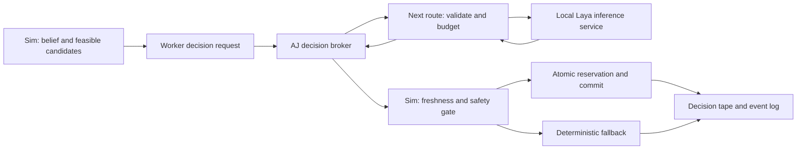

# Plan: migrate FloodSim to bounded Laya-assisted decisions

Date: **15 October 2026**. Status: proposed implementation plan following the user's request. Existing runtime contracts and code remain unchanged by this documentation update. Contract additions require AK/AJ review under `CONTRACTS.md`.

## Objective and boundary

Use Laya to rank or select a small set of meaningful agent actions while the deterministic simulator owns feasibility, movement, collision handling, capacity, power, reservations, fairness rules, and final execution. Preserve negotiation and centralised dispatch as independently selectable comparison modes.

Start with a sidecar inference service and a replaceable provider adapter. Keep deterministic rules as the default. Do not migrate three.js, move the sim onto the main thread, or replace the after-run critic with a classification model.

## Phase 0 — preserve and measure the current baseline

**Owners: AK + AJ.**

- Inventory `src/contracts/mocks/sim.ts`, `src/bridge/ScenarioPreview.ts`, `mockSim.worker.ts`, `createSimWorker.ts`, `SimBridge.ts`, the feed store, and inspector. Existing private mock methods are scaffolding, not a production extension interface.
- Record fixed-seed snapshots, event summaries, and renderer performance before migration. Preserve current editor saves and the Worker 2/AJ changes already in progress.
- Add the missing production `src/sim` and headless comparison entry points before making outcome claims. Restore `sim:batch` and `sim:compare` as real scripts; they are described in the docs but absent from current package scripts.
- Fix movement foundations: derive/build a footpath graph with explicit crossings and entrances; use a separate road/lane graph for vehicles and water/air graphs for boats/helicopters. Keep NPC spawn locations and paths out of building solids and ordinary vehicle lanes. A cosmetic positional offset is not a navigation fix.
- Implement capacity reservations, power/generator eligibility, operating limits, route validation, and assignment re-queueing in the production simulator.

**Exit:** rules-only runs are deterministic and pass the judged invariants. The render/worker protocol still works, and the editor remains usable with mocks.

## Phase 1 — approve versioned decision contracts

**Owners: AK + AJ, with Worker 3 for trace/evaluation needs.**

Propose the fields listed in the appended `CONTRACTS.md` section, with Zod schemas and fixtures. Add optional decision configuration to run options; its default must reproduce rules-only behaviour. Keep decision policy separate from `dispatchMode`.

Add a worker-to-main decision-request message and a main-to-worker decision-result message. Include run identity, episode/generation, request ID, originating tick, candidate-set version/hash, observation hash, navigation/resource versions, and expiry tick. Late responses from a previous load, branch, seek, or restart must be rejected.

Version the run archive to include a decision tape and model/policy metadata. Continue accepting old scenario/run files as rules-only data; do not silently infer that an old seed reproduces an online model run. The tape is separate from the current primitive-only `SimEvent.data`; events reference a decision ID.

**Exit:** malformed, duplicate, wrong-run, stale, and out-of-set result fixtures are rejected without mutating sim state. No shared type is added ad hoc outside `src/contracts`.

## Phase 2 — extract a pure decision boundary

**Owner: AK. Proposed files: `src/sim/decisions/{observe,candidates,policy,gate,commit}.ts`.**

- Build role-specific observations from that agent's belief, report confidence/age, and permitted knowledge. Use ground truth only for declared baseline visibility and the authoritative execution safety gate.
- Generate at most five feasible hospital candidates initially, with stable candidate IDs, travel cost, available capacity, power/generator status, and relevant route/resource versions. Add a defined defer/escalate action when needed.
- Run the existing deterministic scorer through the same boundary first. Resolve score ties with a stable candidate-ID order.
- Gate all returned choices against current world state, the approved action set, and configured eligibility. Reserve units, beds, and seats atomically; on conflict, re-evaluate or re-queue.
- Keep utility values and model probabilities distinct in traces. Derive explanations from candidates, constraints, and the committed result; do not label a generated sentence as the model's internal reasoning.

**Exit:** rules-only behaviour is maintained or deliberately changed with documented regression evidence. Pure sim modules import no SDK, HTTP client, React, Next.js, three.js, or wall-clock API.

## Phase 3 — implement the local provider and broker

**Owners: Worker 3 (provider) + AJ (route/broker) + AK (worker scheduling).**

Proposed integration locations:

| Location | Responsibility |
|---|---|
| `services/laya/` | Pinned inference environment, model cache, startup/warm-up, and health/readiness checks |
| `src/ai/decisions/providers/laya.ts` | Translate bounded observations/questions to Laya and normalise response evidence |
| `app/api/agent-decisions/route.ts` | Server-side request validation, authentication, request/concurrency limits, timeouts, and run budgets |
| `src/bridge/decisionBroker.ts` | Correlate worker requests and replies, cancellation, backpressure, and restart/seek generation changes |
| `src/sim/decisions/` | Pure candidate construction, deterministic policy, gate, and atomic commit |

Use the official `POST /v1/systemone` service initially. Bind a local deployment to loopback; keep any bearer secret server-side. Configure the service origin on the server rather than accepting arbitrary client-provided URLs. Pin SDK/model/tokenizer/calibration revisions; pre-download and warm the checkpoint outside the sim tick. The official HTTP documentation distinguishes response confidence fields and exposes truncation evidence: normalise those explicitly instead of assuming a single interchangeable confidence number. [Laya HTTP API](https://nandhakishorm.github.io/laya/http-api/).

Reject truncated observations, missing/non-finite probability values, invalid distributions, unknown candidate IDs, and unsupported response types. Do not use `action.act_probability` as an execution permit. Choose a calibration/abstention policy only after evaluating the exact checkpoint and question shape.

No endpoint, SDK, model download, hosting purchase, or secret is introduced by this plan itself.

**Exit:** an adapter smoke test works locally; unavailable service, authentication failure, overload, timeout, and malformed responses lead to deterministic fallback and an explicit trace.

## Phase 4 — schedule, record, and replay

**Owners: AK + AJ + Worker 3.**

Start with critical state transitions, not per-agent/per-tick requests. Initial tunable experiment limits: 16 decisions per batch, at most one batch per 30 simulated ticks, no repeated request for an unchanged observation, and a per-run decision cap. These are starting budgets, not validated throughput guarantees. Safety rechecks and necessary deterministic replanning continue immediately even when the model budget is exhausted.

Provide two declared timing modes:

- **Interactive:** requests target a future decision window; at that tick the sim uses a valid available result or falls back. Wall-clock arrival can change the first run's decisions. Record the actual applied tick, fallback, and rejection outcome.
- **Controlled evaluation:** pause sim advancement at an eligible decision boundary while inference resolves, without blocking the renderer. Record any timeout/error fallback. Replay consumes the tape without contacting a model.

The existing tick order is preserved: perception precedes decision selection, and selected actions commit during the decision stage before movement. In-flight network promises never mutate sim state directly. Responses are queued and consumed in stable order at decision boundaries.

Determinism for rules-only runs remains scenario + seed + recorded external inputs. Determinism for assisted replay additionally requires the **recorded decision tape and versioned sim/policy configuration**. Pinning a model or lowering randomness alone does not establish bit-for-bit GPU reproducibility.

**Exit:** replay needs no network; response reordering, duplicate delivery, restart, branch, and seek cannot apply a stale result. Injected events still work, and 1×/4×/16× behaviour follows the declared timing mode.

## Phase 5 — evaluate in shadow mode

**Owners: AK + Worker 3; Worker 2 displays decision evidence.**

Laya observes eligible states but never changes assignments in this phase. Capture at least 500 labelled synthetic decision cases as an initial target, stratified by ordinary conditions, route closure, hospital overflow, blackout, wind grounding, false reports, and resource contention. Keep calibration, tuning, and test scenarios/seeds separate; prevent correlated snapshots from the same episode leaking across splits.

Measure accuracy against reviewed feasible actions, calibration/Brier score, fallback and abstention coverage, truncation, latency p50/p95, memory, queue depth, and cost. Incumbent agreement alone is not correctness. Counterfactual rollouts can assess outcomes but must not give an online agent ground-truth information it is not allowed to observe. The official adoption guide likewise recommends shadowing and workload-specific eligibility. [Staged adoption](https://nandhakishorm.github.io/laya/staged-adoption/).

**Exit:** publish a report on the held-out cases. If Laya underperforms or cannot meet latency/resource budgets, retain shadow/rules mode; fine-tuning or another provider is optional, not a forced next step.

## Phase 6 — enable one bounded slice and compare outcomes

**Owners: AK + AJ + Worker 3.**

Enable assisted hospital selection only in evaluated conditions. Keep the rest of dispatch deterministic and preserve both required dispatch modes. Expose explicit rules/shadow/assisted labels, current model revision, decision source, calibrated policy outcome, alternatives, rejection reason, and fallback counts in the inspector/run report.

Run paired scenario seeds across rules-only and assisted policies, separately for negotiation and centralised dispatch. Hold scenarios, exogenous event schedules, and information assumptions constant. Each policy generates its own state-dependent tape: do not reuse a candidate decision from a different trajectory merely because the seed matches.

Agree promotion thresholds before examining the final test set. Required gates: zero invariant violations, exact offline tape replay, no lost assignments, and no unacceptable service/fairness regression. Report time-to-service p90, unmet requests, stranded people, capacity/power violations, fairness, and uncertainty across seeds. Roll back to rules mode if the gate fails.

## Effort and decision points

Planning estimate, not a delivery promise: roughly **3–5 focused engineer-days** for a standalone provider/contract prototype once the pure decision interface exists; **another 5–10 engineer-days** for tape replay, evaluation, UI evidence, and hardening. Building the missing production simulator and fixing pedestrian/traffic logic are separate prerequisite work and can dominate the schedule. Fine-tuning and domain validation are additional work.

Make spending decisions after Phase 3 profiling. Prefer existing local compute first. The current evidence and charge examples are in [LAYA_FEASIBILITY.md](LAYA_FEASIBILITY.md). Real-city replicas remain a separate future phase; no real maps, personal data, or live emergency dispatch are introduced here.
